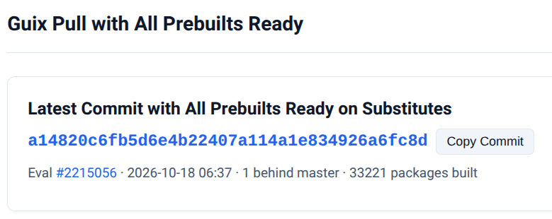

# Guix Pull Ready

Find the newest GNU Guix master commit whose prebuilt binaries (substitutes) are 100% ready on [Cuirass](https://ci.guix.gnu.org), allowing you to run `guix pull` or reconfigure systems without triggering long local builds from source.

> **Note:** This serves as a temporary community solution until official support lands (work on similar functionality upstream in GNU Guix is currently underway).

Public instance: **https://guix-pull-ready.whhone.com**



## How It Works

1. **Evaluations and Jobs**: When commits are pushed to GNU Guix, the build farm ([Cuirass](https://ci.guix.gnu.org)) creates an **evaluation** with build **jobs** for all packages on each architecture (e.g. `x86_64-linux`).
2. **Background Sync**: This service polls Cuirass in the background and caches job statuses locally, ensuring instant responses without upstream CI timeouts.
3. **Ready Commit Lookup**:
   - **Whole system (default)**: Finds the newest commit whose evaluation has 0 pending builds remaining (and where the `guix` jobset for `guix pull` is ready).
   - **Package mode (`?pkgs=...`)**: Finds the newest commit where your selected packages are already built, without waiting for the rest of the distribution to finish.
   - **Coordinated Nonguix channel (`?additional_channels=nonguix`)**: Matches evaluations on [`cuirass.nonguix.org`](https://cuirass.nonguix.org/jobset/nonguix) with the exact `guix` commit they were evaluated against on [`ci.guix.gnu.org`](https://ci.guix.gnu.org), ensuring substitutes are ready across both channels simultaneously.

## Quick Start

### 1. Update Guix directly to the newest ready commit

```bash
guix pull -C <(curl -fsSL "https://guix-pull-ready.whhone.com/channels.scm")
```

### 2. Track automatically via channels.scm

Configure `~/.config/guix/channels.scm` to automatically fetch the newest ready commit on every `guix pull` using Guix's built-in `downloaded-channels`:

```scheme
(downloaded-channels
  "https://guix-pull-ready.whhone.com/channels.scm")
```

To learn more, see the GNU Guix manual section on [Channels with Substitutes](https://guix.gnu.org/manual/devel/en/html_node/Channels-with-Substitutes.html).

### 3. Include the Nonguix channel (`?additional_channels=nonguix`)

> **IMPORTANT:** `nonguix` substitutes require manual setup. Follow [Substitutes for Nonguix](https://gitlab.com/nonguix/nonguix/#substitutes-for-nonguix) to authorize the Nonguix substitute server.

Pull both `guix` and `nonguix` at their newest coordinated ready commits:

```bash
guix pull -C <(curl -fsSL "https://guix-pull-ready.whhone.com/channels.scm?additional_channels=nonguix")
```

Or track both channels automatically in `~/.config/guix/channels.scm`:

```scheme
(downloaded-channels
  "https://guix-pull-ready.whhone.com/channels.scm?additional_channels=nonguix")
```

### 4. Query for specific packages

Find a commit where your required packages are built (without waiting for the entire evaluation to finish):

```bash
guix pull -C <(curl -fsSL "https://guix-pull-ready.whhone.com/channels.scm?pkgs=emacs,git")

# With nonguix packages (e.g. linux, nvidia-driver):
guix pull -C <(curl -fsSL "https://guix-pull-ready.whhone.com/channels.scm?additional_channels=nonguix&pkgs=emacs,linux")
```

## Self-Hosting

### Run with Podman / Docker Compose

A ready-to-use [`docker-compose.yml`](docker-compose.yml) with Cloudflare Tunnel support is included:

```bash
cp .env.example .env   # Set your TUNNEL_TOKEN if using a Cloudflare named tunnel
podman compose up -d --build
```

### Build from Source (Zero Dependencies)

The server requires only the standard Go toolchain (zero third-party dependencies):

```bash
# Build static binary
CGO_ENABLED=0 go build -trimpath -o guix-sync-server ./cmd/guix-sync-server

# Run locally on :8080
./guix-sync-server --db-path=./guix-sync.db
```

## Known Issues

### Cuirass Upstream `Jobs` Cache Desynchronization

Occasionally, an evaluation may appear stuck with a small number of builds (e.g. 1 to 4 packages) marked as pending indefinitely, even though the underlying builds have already succeeded.

- **Root Cause**: An upstream database race condition in Cuirass (`ci.guix.gnu.org`). Cuirass caches build statuses in a denormalized `Jobs` table populated during evaluation registration, kept in sync with the canonical `Builds` table via a PostgreSQL trigger (`update_job_status`). When an existing build completes concurrently while a new evaluation is being registered, the completion trigger updates existing evaluation rows but misses the newly inserting row. Once a build completes (`status = 0`), Cuirass never issues another `UPDATE` on `Builds` for that derivation, leaving `/api/jobs` permanently reporting `status = -1` (pending) for that evaluation in upstream CI.
- **Impact**: The affected evaluation will not be chosen in whole-system mode (since its pending count never reaches 0). The service simply falls back to the previous evaluation whose builds completed cleanly. Package-mode queries (`?pkgs=...`) for packages not affected by the desynchronized jobs are unaffected.

## License

GPL-3.0-or-later
